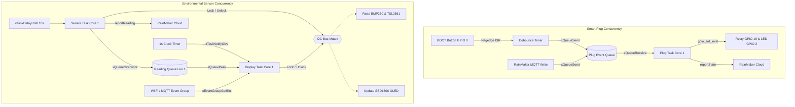

# ESP32 Smart Home System (ESP-IDF / ESP RainMaker)

[](https://platformio.org/)
[](https://docs.espressif.com/projects/esp-idf/en/v5.2.1/)
[-blue.svg)](https://www.espressif.com/en/products/socs/esp32)
[](https://rainmaker.espressif.com/)
[](#45-execute-unit-tests)
[](LICENSE)

An enterprise-grade, two-device Smart Home system built for generic ESP32 DevKit boards using ESP-IDF (C++17) via PlatformIO and ESP RainMaker. This project adapts Chapter 9 ("Project – Smart Home") of *"Developing IoT Projects with ESP32, 2nd Edition"*, featuring clean FreeRTOS concurrency architecture, hardware interrupts, software timers, thread-safe I2C bus arbitration, and native host unit testing.

---

## Table of Contents

- [1. System Overview & Features](#1-system-overview--features)
- [2. Hardware Specifications & Wiring Summary](#2-hardware-specifications--wiring-summary)
  - [2.1 Smart Plug Node](#21-smart-plug-pinout)
  - [2.2 Environmental Sensor Node](#22-environmental-sensor-pinout)
- [3. Architecture & FreeRTOS Concurrency](#3-architecture--freertos-concurrency)
  - [3.1 Concurrency Architecture Diagram](#31-concurrency-architecture-diagram)
  - [3.2 Memory Footprint Summary](#32-memory-footprint-summary)
- [4. Project Structure](#4-project-structure)
- [5. Building and Flashing](#5-building-and-flashing)
  - [5.1 Prerequisites](#51-prerequisites)
  - [5.2 Compile Firmware](#52-compile-firmware)
  - [5.3 Flash to ESP32 Hardware](#53-flash-to-esp32-hardware)
  - [5.4 Serial Monitor](#54-serial-monitor)
  - [5.5 Execute Unit Tests](#55-execute-unit-tests)
- [6. ESP RainMaker Phone App & Provisioning](#6-esp-rainmaker-phone-app--provisioning)
- [7. Cloud & Automation Workflows](#7-cloud--automation-workflows)
  - [7.1 Schedules](#71-schedules)
  - [7.2 Scenes](#72-scenes)
  - [7.3 Automations](#73-automations)
  - [7.4 Voice Assistant Integration (Alexa)](#74-voice-assistant-integration-amazon-alexa)
- [8. Troubleshooting Guide](#8-troubleshooting-guide)

---

## 1. System Overview & Features

The project encompasses two independent firmware targets managed in a single unified PlatformIO workspace:

1. **Smart Plug Node (`plug`)**:
   - **Load Switching**: High-voltage relay control on GPIO 19.
   - **Status Feedback**: Onboard LED indicator on GPIO 2.
   - **Physical Control**: Push button on GPIO 0 (BOOT button) using a falling-edge hardware interrupt (ISR) and a FreeRTOS software debounce timer.
   - **Serialized Execution**: Centralized FreeRTOS queue and worker task (`PlugTask`) arbitrating state changes from both physical inputs and cloud MQTT writes.
   - **Cloud Management**: Two-way state synchronization, OTA updates, time-based schedules, multi-device scenes, and Alexa voice integration via ESP RainMaker.

2. **Environmental Sensor Node (`sensor`)**:
   - **Atmospheric Temperature**: BMP280 precision sensor over shared I2C (`0x76`).
   - **Ambient Light**: TSL2561 luminosity sensor over shared I2C (`0x39`) mapped to a 0–100% intensity scale.
   - **Local Dashboard**: SSD1306 128x64 OLED display over shared I2C (`0x3C`) driven by a self-contained, register-level I2C driver with a built-in 5x7 ASCII font.
   - **Deterministic Sampling**: Periodic acquisition task triggered every 10 seconds via `vTaskDelayUntil()`.
   - **Thread Safety**: Strict FreeRTOS mutex arbitration guarding the shared I2C bus against concurrent access.
   - **Real-Time Clock**: 1-second FreeRTOS software timer notifying the display task for clock rendering.
   - **Network Synchronization**: FreeRTOS Event Group tracking Wi-Fi station connectivity and RainMaker MQTT broker status.

---

## 2. Hardware Specifications & Wiring Summary

### Target Platform
- **Board**: `esp32dev` (Generic ESP32 DevKit V1 / ESP-WROOM-32)
- **Flash Size**: 4MB Flash (configured with custom dual OTA partition table in `partitions.csv`)
- **Target ESP-IDF Version**: ESP-IDF v5.2.1 (`framework-espidf @ 3.50201.240515`)
- **Target PlatformIO Platform**: `platform = espressif32 @ 6.6.0` (pinned to ensure compatible Xtensa toolchain v12.2.0)
- **Component Resolution**: Dependencies (`espressif/esp_rainmaker`, `rmaker_app_network`, `rmaker_app_insights`, `mdns`, `bmp280`, `tsl2561`, `i2cdev`) are resolved declaratively via `src/idf_component.yml` using the ESP-IDF Component Manager.
- **Target Selection**: `platformio.ini` supplies `board_build.cmake_extra_args = -DDEVICE=plug` / `-DDEVICE=sensor` so `src/CMakeLists.txt` selectively compiles only `common/` plus the target device code.

### 2.1 Smart Plug Pinout

| ESP32 Pin | Connected Component | Function / Mode | Active Level | Default State |
|:---|:---|:---|:---|:---|
| **GPIO 19** | 5V Relay IN | Digital Output | HIGH (1 = ON) | LOW (OFF) |
| **GPIO 2** | Onboard LED | Digital Output | HIGH (1 = ON) | LOW (OFF) |
| **GPIO 0** | BOOT Button | Digital Input (Pullup, Negedge ISR) | LOW (0 = Pressed) | Released |
| **VIN (5V)** | Relay VCC | Power Rail | 5V DC | Active |
| **GND** | Relay GND | Common Ground | 0V | Ground |

### 2.2 Environmental Sensor Pinout

| ESP32 Pin | Connected Component | Function / Mode | Notes |
|:---|:---|:---|:---|
| **GPIO 21** | BMP280, TSL2561, SSD1306 SDA | Shared I2C Data (SDA) | Pull-up enabled |
| **GPIO 22** | BMP280, TSL2561, SSD1306 SCL | Shared I2C Clock (SCL)| 100 kHz standard clock |
| **3V3 (3.3V)**| All Sensors & Display VCC | 3.3V Power Rail | Connect to ESP32 3.3V pin |
| **GND** | All Sensors & Display GND | Common Ground | Connect to ESP32 GND pin |

For complete schematics and wiring diagrams, refer to [`docs/hardware.md`](docs/hardware.md).

---

## 3. Architecture & FreeRTOS Concurrency

### 3.1 Concurrency Architecture Diagram



### 3.2 Memory Footprint Summary

Actual build metrics verified on `esp32dev` (ESP-WROOM-32, 4MB Flash):

| Target | RAM Usage | RAM % | Flash Usage | Flash % | Partition Limit |
|:---|:---|:---|:---|:---|:---|
| **`plug`** | 52,616 bytes | 16.1% | 1,557,733 bytes | 79.2% | 1,966,080 bytes (`ota_0`) |
| **`sensor`** | 54,116 bytes | 16.5% | 1,537,649 bytes | 78.2% | 1,966,080 bytes (`ota_0`) |

Stack high-water marks are continuously monitored at runtime via `uxTaskGetStackHighWaterMark()` and logged over UART. Detailed FreeRTOS object configurations are documented in [`docs/design.md`](docs/design.md).

---

## 4. Project Structure

```
esp32-smart-home/
├── README.md                    # System documentation and operational guide
├── .gitignore                   # Git ignore rules for build artifacts and temporary files
├── platformio.ini               # Two environments: plug, sensor
├── CMakeLists.txt               # ESP-IDF root project definition
├── sdkconfig.defaults           # Default configuration (4MB flash, dual OTA, BLE, RainMaker)
├── partitions.csv               # 4MB flash partition table with two ~1.9MB OTA slots
├── docs/
│   ├── hardware.md              # Parts list, pin tables, electrical wiring schematics
│   └── design.md                # Class diagram, RTOS concurrency tables, sequence diagrams
├── include/                     # Headers (mirrors src/)
│   ├── common/
│   │   ├── network.hpp          # NVS and Wi-Fi provisioning controller
│   │   └── rainmaker_node.hpp   # Base RainMaker node (OTA, system service, scenes)
│   ├── plug/
│   │   ├── config.hpp           # Hardware pin assignments and RTOS parameters
│   │   ├── relay.hpp            # Relay and status LED driver interface
│   │   ├── button.hpp           # ISR and software-timer debounce button handler
│   │   ├── plug_task.hpp        # Relay control and command serialization task
│   │   └── plug_node.hpp        # Smart plug RainMaker device implementation
│   └── sensor/
│       ├── config.hpp           # I2C configuration, addresses, and RTOS constants
│       ├── reading.hpp          # Sensor reading data structures
│       ├── logic.hpp            # Pure mapping functions (lux -> 0-100), unit-testable
│       ├── i2c_bus.hpp          # Mutex-guarded I2C bus driver
│       ├── temperature_sensor.hpp # BMP280 sensor driver wrapper
│       ├── light_sensor.hpp     # TSL2561 sensor driver wrapper
│       ├── oled_display.hpp     # SSD1306 OLED display driver
│       ├── sensor_task.hpp      # Periodic 10s sensor sampling task
│       ├── display_task.hpp     # 1s OLED display and clock update task
│       └── sensor_node.hpp      # Sensor RainMaker device implementation
├── src/                         # Implementations (mirrors include/)
│   ├── CMakeLists.txt           # Selects sources based on target device
│   ├── idf_component.yml        # Managed dependencies from Espressif Component Registry
│   ├── common/
│   │   ├── network.cpp          # NVS setup and BLE provisioning implementation
│   │   └── rainmaker_node.cpp   # Base node logic, OTA, and cloud event callbacks
│   ├── plug/
│   │   ├── main.cpp             # Startup wiring for the plug
│   │   ├── relay.cpp            # Relay and LED control implementation
│   │   ├── button.cpp           # Interrupt service routine and debounce timer logic
│   │   ├── plug_task.cpp        # Event processing loop and watermark logging
│   │   └── plug_node.cpp        # RainMaker parameter registration and write handling
│   └── sensor/
│       ├── main.cpp             # Startup wiring for the environmental sensor
│       ├── i2c_bus.cpp          # I2C master driver with FreeRTOS mutex
│       ├── temperature_sensor.cpp # BMP280 data reading and error handling
│       ├── light_sensor.cpp     # TSL2561 data reading and error handling
│       ├── oled_display.cpp     # OLED buffer rendering and frame flush
│       ├── sensor_task.cpp      # Periodic sampling, conversion, and cloud reporting
│       ├── display_task.cpp     # Screen formatting and 1s timer handling
│       └── sensor_node.cpp      # Temperature & light param publishing
└── test/
    └── test_sensor_logic.cpp    # Unity native unit tests for logic.hpp
```

---

## 5. Building and Flashing

### 5.1 Prerequisites
- [PlatformIO Core (CLI)](https://docs.platformio.org/en/latest/core/index.html) or PlatformIO IDE extension for VS Code.
- USB-to-UART driver (CP2102 or CH340) installed.

### 5.2 Compile Firmware

To compile either device firmware:

```bash
# Build the smart plug firmware
pio run -e plug

# Build the environmental sensor firmware
pio run -e sensor
```

### 5.3 Flash to ESP32 Hardware

Connect the corresponding ESP32 DevKit to your computer via USB and upload:

```bash
# Flash Smart Plug
pio run -e plug -t upload

# Flash Environmental Sensor
pio run -e sensor -t upload
```

### 5.4 Serial Monitor

Launch the serial terminal to monitor logs and stack high-water marks:

```bash
# Monitor the Smart Plug
pio device monitor -e plug

# Monitor the Environmental Sensor
pio device monitor -e sensor
```

### 5.5 Execute Unit Tests

The mathematical transformation (`luxToLightIntensity`) is isolated in `include/sensor/logic.hpp` without hardware dependencies. Run the native host tests:

```bash
# Compile and execute with host GCC/G++
g++ -Iinclude -I"C:\Users\User\.platformio\packages\framework-espidf@3.50201.240515\components\unity\unity\src" "C:\Users\User\.platformio\packages\framework-espidf@3.50201.240515\components\unity\unity\src\unity.c" test/test_sensor_logic.cpp -o test_sensor_logic
./test_sensor_logic
```

---

## 6. ESP RainMaker Phone App & Provisioning

1. **Install Mobile App**: Download the **ESP RainMaker** app from the App Store (iOS) or Google Play Store (Android).
2. **Account Sign-in**: Create or log in to your Espressif RainMaker account.
3. **Provisioning (BLE)**:
   - Power on the ESP32 device.
   - Tap **Add Device** (`+` icon) in the RainMaker app.
   - The device advertises over Bluetooth Low Energy (BLE).
   - When prompted for a Proof-of-Possession (PoP) code, enter the 8-character random code printed in the serial monitor at boot.
   - Select your 2.4 GHz Wi-Fi network and enter credentials.
   - Once connected, the device establishes a secure MQTT connection with the ESP RainMaker cloud broker.
4. **Dashboard View**:
   - **Plug**: Displays a toggle switch named "power". Toggling updates the physical relay (GPIO 19) and onboard LED (GPIO 2) instantaneously.
   - **Sensor**: Displays real-time temperature (°C) and light intensity (%) gauges updated every 10 seconds.

---

## 7. Cloud & Automation Workflows

### 7.1 Schedules
- Open the device in the RainMaker app, navigate to **Schedules**, and tap **Add Schedule**.
- Configure actions (e.g., Turn ON plug at 07:00 AM every Monday through Friday).
- The schedule synchronizes to the device's internal RTC and executes autonomously even during internet outages.

### 7.2 Scenes
- Navigate to the **Scenes** tab in the app.
- Create a scene named "Good Night" and assign actions across both devices (e.g., Plug power -> OFF).
- Execute the scene with a single tap to trigger multi-device actions concurrently.

### 7.3 Automations
- In the RainMaker app, open **Automations** -> **Create Automation**.
- Set **Condition**: Sensor device -> `light-intensity` < 20%.
- Set **Action**: Plug device -> `power` = ON.
- Cover the TSL2561 sensor to observe the plug turning ON automatically via the cloud rules engine.

### 7.4 Voice Assistant Integration (Amazon Alexa)
- Enable the **ESP RainMaker** Skill in the Amazon Alexa app.
- Link your ESP RainMaker account.
- Discover devices: Alexa detects "Plug" and "Sensor".
- Test voice commands:
  - *"Alexa, turn on the Plug."*
  - *"Alexa, what is the temperature on Sensor?"*

---

## 8. Troubleshooting Guide

| Issue | Probable Cause | Corrective Action |
|:---|:---|:---|
| Relay does not click on state change | Incorrect GPIO or power supply | Ensure relay VCC is connected to 5V (VIN), and IN is on GPIO 19. Check active level setting in `include/plug/config.hpp`. |
| Display is blank or shows artifacts | I2C address mismatch or pull-up issue | Verify OLED address is `0x3C`. Ensure SDA (GPIO 21) and SCL (GPIO 22) connections are firm and powered at 3.3V. |
| Sensor read failure logged in serial console | I2C communication error | Check BMP280 (`0x76`) and TSL2561 (`0x39`) wiring. The driver gracefully suppresses cloud reporting on read error to prevent erroneous data publication. |
| Wi-Fi fails to connect during BLE provisioning | 5 GHz network selected | ESP32 only supports 2.4 GHz Wi-Fi networks. Ensure the router 2.4 GHz band is broadcast. |
| Flash overflow during compilation | Partition table too small | Ensure `board_build.partitions = partitions.csv` is active in `platformio.ini` to allocate 1.9MB dual OTA slots. |
| Toolchain assembler error (`--dynconfig=xtensa_esp32.so`) | MSYS2 or MinGW `as.exe` shadowing the toolchain on PATH | Pin `platform = espressif32 @ 6.6.0` in `platformio.ini` to use the self-contained `toolchain-xtensa-esp32` package. |
| Linker error: `.iram0.text` overflowed `iram0_0_seg` | FreeRTOS/Wi-Fi/mbedTLS functions placed in IRAM | Enabled `CONFIG_FREERTOS_PLACE_FUNCTIONS_INTO_FLASH=y`, `CONFIG_ESP_WIFI_IRAM_OPT=n`, and NimBLE in `sdkconfig.defaults`. |
