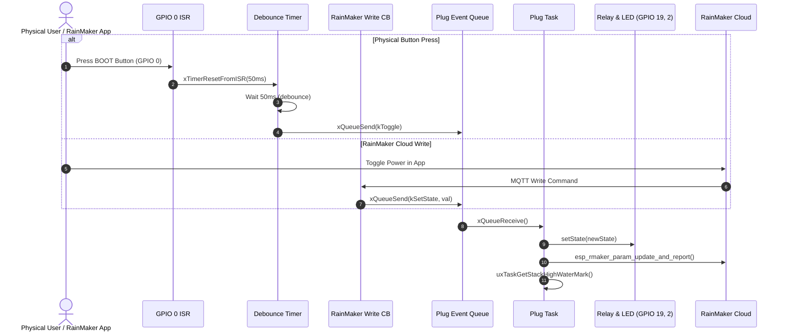
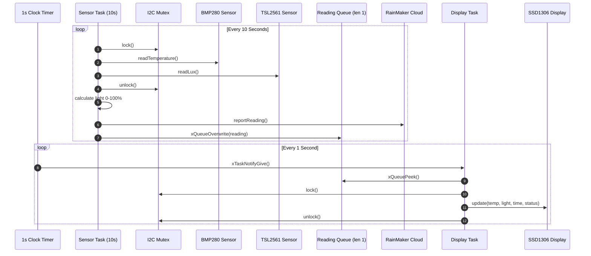

<!-- Software architecture, class diagram, and FreeRTOS synchronization primitives. -->

# Software Design Document: ESP32 Smart Home

This document describes the object-oriented architecture, FreeRTOS task concurrency model, communication queues, synchronization mutexes, software timers, and event groups.

---

## 1. Class Architecture

```mermaid
classDiagram
    namespace common {
        class Network {
            -EventGroupHandle_t m_eventGroup
            -EventBits_t m_connectedBit
            -bool m_connected
            +init(EventGroupHandle_t, EventBits_t) esp_err_t
            +start() esp_err_t
            +isConnected() bool
            -wifiEventHandler(void*, esp_event_base_t, int32_t, void*) void
        }

        class RainMakerNode {
            <<abstract>>
            #NodeConfiguration m_configuration
            #esp_rmaker_node_t* m_nodeHandle
            #esp_rmaker_device_t* m_deviceHandle
            #EventGroupHandle_t m_eventGroup
            #EventBits_t m_mqttBit
            #bool m_connected
            +init(EventGroupHandle_t, EventBits_t) esp_err_t
            +start() esp_err_t
            +isConnected() bool
            #onDeviceInit(esp_rmaker_device_t*)* void
            #onMqttConnected() void
            #onMqttDisconnected() void
            -rmakerEventHandler(void*, esp_event_base_t, int32_t, void*) void
        }
    }

    namespace plug {
        class Relay {
            -bool m_state
            +init() esp_err_t
            +setState(bool state) void
            +getState() bool
        }

        class Button {
            -QueueHandle_t m_eventQueue
            -TimerHandle_t m_debounceTimer
            +init(QueueHandle_t eventQueue) esp_err_t
            -isrHandler(void* arg) void
            -debounceTimerCallback(TimerHandle_t timer) void
        }

        class PlugNode {
            -esp_rmaker_param_t* m_powerParam
            -QueueHandle_t m_eventQueue
            +setEventQueue(QueueHandle_t eventQueue) void
            +reportState(bool state) esp_err_t
            #onDeviceInit(esp_rmaker_device_t* device) void
            -writeCallback(...) esp_err_t
        }

        class PlugTask {
            -Relay& m_relay
            -PlugNode& m_plugNode
            -QueueHandle_t m_eventQueue
            -TaskHandle_t m_taskHandle
            +start() esp_err_t
            +getEventQueue() QueueHandle_t
            -taskFunction(void* arg) void
        }
    }

    namespace sensor {
        class I2cBus {
            -SemaphoreHandle_t m_mutex
            -i2c_port_t m_port
            -bool m_initialized
            +init() esp_err_t
            +lock(TickType_t timeout) bool
            +unlock() void
            +getMutex() SemaphoreHandle_t
            +getPort() i2c_port_t
        }

        class TemperatureSensor {
            -bmp280_t m_device
            -bmp280_params_t m_params
            -bool m_initialized
            +init(i2c_port_t port) esp_err_t
            +readTemperature(float& temperature) esp_err_t
        }

        class LightSensor {
            -tsl2561_t m_device
            -bool m_initialized
            +init(i2c_port_t port) esp_err_t
            +readLux(uint32_t& lux) esp_err_t
        }

        class OledDisplay {
            -i2c_port_t m_port
            -bool m_initialized
            -uint8_t m_buffer[1024]
            +init(i2c_port_t port) esp_err_t
            +update(float, uint8_t, bool, bool, bool, const char*) void
            +clear() void
        }

        class SensorNode {
            -esp_rmaker_param_t* m_temperatureParam
            -esp_rmaker_param_t* m_lightIntensityParam
            +reportReading(float temp, uint8_t intensity) esp_err_t
            #onDeviceInit(esp_rmaker_device_t* device) void
        }

        class SensorTask {
            -I2cBus& m_i2cBus
            -TemperatureSensor& m_temperatureSensor
            -LightSensor& m_lightSensor
            -SensorNode& m_sensorNode
            -QueueHandle_t m_readingQueue
            -TaskHandle_t m_taskHandle
            +start() esp_err_t
            +getReadingQueue() QueueHandle_t
            -taskFunction(void* arg) void
        }

        class DisplayTask {
            -I2cBus& m_i2cBus
            -OledDisplay& m_display
            -QueueHandle_t m_readingQueue
            -EventGroupHandle_t m_eventGroup
            -TimerHandle_t m_clockTimer
            -TaskHandle_t m_taskHandle
            -SensorReading m_latestReading
            +start() esp_err_t
            -taskFunction(void* arg) void
            -clockTimerCallback(TimerHandle_t timer) void
        }
    }

    RainMakerNode <|-- PlugNode
    RainMakerNode <|-- SensorNode
    PlugTask --> Relay
    PlugTask --> PlugNode
    Button ..> PlugTask : posts events
    SensorTask --> I2cBus
    SensorTask --> TemperatureSensor
    SensorTask --> LightSensor
    SensorTask --> SensorNode
    DisplayTask --> I2cBus
    DisplayTask --> OledDisplay
```

---

## 2. FreeRTOS Concurrency Architecture

### 2.1 Tasks Table

| Device | Task Name | Priority | Stack Size | Core Affinity | Timing / Trigger | Responsibilities |
|--------|-----------|----------|------------|---------------|------------------|------------------|
| Plug | `plug_task` | 5 | 4096 bytes | Core 1 | Blocked on `m_eventQueue` | Receives button toggle or cloud write events, drives relay GPIO 19 and LED GPIO 2, reports updated parameter to RainMaker cloud, logs stack watermark. |
| Sensor | `sensor_task` | 5 | 4096 bytes | Core 1 | `vTaskDelayUntil` (10 s) | Periodically acquires I2C mutex, samples BMP280 temperature and TSL2561 lux, checks error codes, calculates 0–100 light metric, pushes to queue with overwrite, reports to RainMaker. |
| Sensor | `display_task` | 4 | 4096 bytes | Core 1 | Task notification from 1s timer / timeout | Reads latest sensor reading from queue, queries Wi-Fi/MQTT event group bits, formats clock time, acquires I2C mutex, refreshes SSD1306 OLED. |

---

### 2.2 Queues Table

| Device | Queue Handle | Length | Item Type | Producer(s) | Consumer | Purpose |
|--------|--------------|--------|-----------|-------------|----------|---------|
| Plug | `m_eventQueue` | 10 | `PlugEvent` (type, targetState) | `Button::debounceTimerCallback`, `PlugNode::writeCallback` | `PlugTask` | Thread-safe serialization of physical button presses and cloud RainMaker toggle commands. |
| Sensor | `m_readingQueue` | 1 | `SensorReading` (temp, light, valid) | `SensorTask` | `DisplayTask` | Carries the freshest sensor reading to the display task using `xQueueOverwrite()` without blocking the sensor task. |

---

### 2.3 Mutex Table

| Device | Mutex Handle | Type | Protected Resource | Timeout | Purpose |
|--------|--------------|------|--------------------|---------|---------|
| Sensor | `m_mutex` (in `I2cBus`) | Standard Mutex (`xSemaphoreCreateMutex`) | I2C Hardware Bus & SSD1306 Display | 1000 ms (`kI2cMutexTimeoutTicks`) | Prevents bus contention and frame corruption between periodic sensor reads (`sensor_task`) and display frame flushes (`display_task`). |

---

### 2.4 Software Timers Table

| Device | Timer Name | Period | Auto-Reload | Callback | Purpose |
|--------|------------|--------|-------------|----------|---------|
| Plug | `btn_deb` | 50 ms | One-shot (`pdFALSE`) | `Button::debounceTimerCallback` | Debounces BOOT button negative-edge hardware interrupts before queuing `kToggle` event. |
| Sensor | `clk_tmr` | 1000 ms | Periodic (`pdTRUE`) | `DisplayTask::clockTimerCallback` | 1 Hz clock tick that wakes `display_task` via task notifications for real-time OLED clock updates. |

---

### 2.5 Event Groups Table

| Device | Event Group Handle | Bit Mask | Bit Constant | Set By | Cleared By | Awaited By |
|--------|--------------------|----------|--------------|--------|------------|------------|
| Sensor | `g_eventGroup` | `0x01` | `kWifiConnectedBit` | `Network::wifiEventHandler` (`IP_EVENT_STA_GOT_IP`) | `Network::wifiEventHandler` (`WIFI_EVENT_STA_DISCONNECTED`) | `DisplayTask` |
| Sensor | `g_eventGroup` | `0x02` | `kMqttConnectedBit` | `RainMakerNode::rmakerEventHandler` (`RMAKER_MQTT_EVENT_CONNECTED`) | `RainMakerNode::rmakerEventHandler` (`RMAKER_MQTT_EVENT_DISCONNECTED`) | `DisplayTask` |

---

## 3. Sequence Diagrams

### 3.1 Plug Event Flow

### 3.2 Sensor Execution Flow

